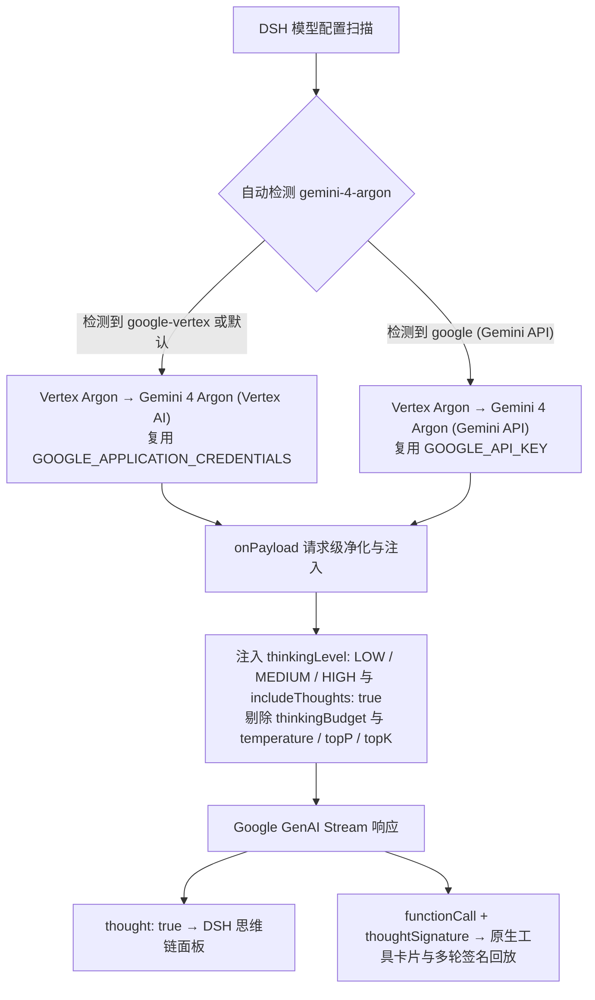

<div align="center">
  
  <h1>dsh-vertex-argon</h1>
  <p><strong>Google Vertex AI &amp; Gemini API Dual-Route Gemini 4 Argon Plugin for <a href="https://github.com/deepseek-ai/deepseek-harness">DeepSeek Harness</a> (DSH)</strong></p>
  <p>
    <a href="https://www.npmjs.com/package/dsh-vertex-argon"></a>
    <a href="https://github.com/deepseek-ai/deepseek-harness"></a>
    <a href="https://docs.cloud.google.com/gemini-enterprise-agent-platform/models/gemini/4-argon"></a>
    <a href="./LICENSE"></a>
  </p>
</div>

---

`dsh-vertex-argon` 为 [DeepSeek Harness](https://github.com/deepseek-ai/deepseek-harness) (DSH) 提供完整的 **Gemini 4 Argon** 接入支持，自动聚合 **Google Vertex AI**（服务账号 / ADC）与 **Google Gemini Developer API**（AI Studio API Key）双通道，修复内置 `pi-ai` 适配器误传 `thinkingBudget` 导致的 `HTTP 400` 报错，完整打通原生三档思考、思维链（Thought Summaries）与带签名的多轮工具调用。

Current release: **[1.1.3](https://github.com/higekibaka/dsh-vertex-argon)** · [npm](https://www.npmjs.com/package/dsh-vertex-argon)

---

## ✨ 为什么需要这个插件？

| 能力维度 | DSH 内置 `google` / `google-vertex` 旧适配器 | `dsh-vertex-argon` 插件通道 |
|---|---|---|
| **思考控制参数** | 误判为旧模型并发送 `thinkingBudget: -1`，触发云端 `HTTP 400` | 原生发送 `thinkingLevel: "LOW" \| "MEDIUM" \| "HIGH"`，绝不传 `thinkingBudget` |
| **思维链（思考摘要）** | 手动新增模型默认无 `reasoning` 标记，不请求摘要 | 固定开启 `includeThoughts: true`，流式解析 `thought: true` 实时展示思维链 |
| **多轮工具调用回传** | 路由切换或签名不对齐时易丢失上下文 | 保持 `provider` / `model` 与 `thoughtSignature` 签名全链路一致 |
| **采样参数净化** | 可能携带被 Argon 拒绝或忽略的采样字段 | 自动剥离 `temperature`、`topP`、`topK` 等无效采样参数 |
| **通道管理与设置** | 需手改 `cordis.patch.yml` 并反复排查校验报错 | 自动检测双通道 + 内置 **设置 → Vertex Argon** 图形化实时调节页面 |

---

## 🔄 工作原理与架构流向



除提供独立的 **Vertex Argon** 分组外，插件在启动时还会为内置 `PiAiAdapter` 注入 `installGemini4PiAiPatch` 运行时兜底——即便用户在模型选择器中误点了原 `Google` 或 `Google Vertex AI` 分组下的 `gemini-4-argon`，也会被自动改写为合法的 `thinkingLevel` 请求。

---

## 🚀 安装方法

### 方式 1：在 DSH 对话框中一键安装（推荐）

直接向当前 DSH 会话发送：

```text
请用 plugin_manager 的 install_bundle 安装 dsh-vertex-argon
```

> 若本机默认配置了尚未同步新包的镜像源，可发送：
> `请用 plugin_manager 的 install_bundle 从 https://registry.npmjs.org/ 安装 dsh-vertex-argon`

### 方式 2：使用 DSH CLI 安装

```sh
dsh plugin --profile web add dsh-vertex-argon
```

---

## 🔑 双通道凭据配置（二选一或同时配置）

### 通道 A：Google Vertex AI（服务账号 JSON / ADC）

1. 在 [Google Cloud 控制台](https://console.cloud.google.com/) 确认项目已绑定结算账户、已启用 **Vertex AI API**（`aiplatform.googleapis.com`），并为服务账号授予 **Vertex AI User**（`roles/aiplatform.user`）角色，下载 JSON 密钥文件。
2. 在系统用户环境变量中设置以下 3 项（Windows 打开「编辑账户的环境变量 → 用户变量」新建，**变量值不要加引号**）：

| 环境变量名 | 填写示例 | 说明 |
|---|---|---|
| `GOOGLE_APPLICATION_CREDENTIALS` | `C:\Keys\vertex-sa.json` | 服务账号 JSON 密钥文件的完整本地路径 |
| `GOOGLE_CLOUD_PROJECT` | `my-gcp-project-id` | Google Cloud **项目 ID**（注意不是项目名称） |
| `GOOGLE_CLOUD_LOCATION` | `global` | 调用区域，推荐 `global`（或 `us` / `eu`） |

3. **完全退出 DSH（含右下角系统托盘图标）并重新启动**，使进程继承新的环境变量。
4. 在会话模型选择器中选择 **`Vertex Argon → Gemini 4 Argon (Vertex AI)`**。

### 通道 B：Google Gemini API（AI Studio API Key）

1. 打开 DSH **设置 → 模型 → Google**，配置你的 `GOOGLE_API_KEY`。
2. 在 `Google` 提供商下添加模型 ID：`gemini-4-argon`。
3. 插件会自动检测到该配置，并在模型选择器的 **`Vertex Argon`** 分组下多显示一项 **`Gemini 4 Argon (Gemini API)`**，点击即可直接调用。

---

## ⚙️ 设置页面与配置项（Configuration）

打开左下角 **设置 → Vertex Argon**，无需修改 YAML 或重启应用，即可实时调整以下配置（对应 `local-vertex-argon` Profile 条目）：

| 配置字段 | 默认值 | 可选范围 / 预设 | 说明 |
|---|---|---|---|
| `showInModelPicker` | `true` | `true` / `false` | 是否在会话模型选择器中显示 `Vertex Argon` 分组（隐藏不影响已打开会话） |
| `reasoning` | `medium` | `low` / `medium` / `high` | 默认思考档位，分别映射为原生 `LOW` / `MEDIUM` / `HIGH` |
| `maxTokens` | `65536` | `1` – `65536` | 单次流式请求最大输出上限（含思考与正文 token，官方单次流式上限为 `65,536`） |
| `contextWindow` | `1048576` | `1` – `1048576` | 输入、思考与输出共享的总上下文窗口（官方上限为 `1,048,576`） |

---

## ⚠️ 与 billion-context 配合使用的已知问题

### Vertex 工具续答 400（2026-10-14）

在 **DSH 0.2.0-rc.2 / dsh-vertex-argon 1.1.4 / billion-context 0.1.196** 上，已复现：工具执行成功后，Bili 将压缩提醒（nudge）追加到最后一个 user 消息的工具结果后面，Vertex 拒绝下一次请求：

> HTTP 400: Requests ending with a model turn are not supported.

这条报错容易误导：实际请求仍以 user 消息结束，且工具结果没有丢失；本次触发点是同一消息内的 **parts 顺序**，不是 Argon 的 thinkingLevel 参数或思考摘要开关。

| 最后一个 user 消息的 parts | 官方 Vertex 实测 |
|---|---|
| functionResponse | 200，正常续答 |
| functionResponse → text（短提醒或完整 Bili nudge） | 400，上述报错 |
| text（同一提醒）→ functionResponse | 200，正常续答 |

测试使用新生成、带签名的 add(37,29) 调用，保持模型消息和签名不变，仅改变工具结果与提醒的顺序，成功组均得到 66。另一次直接 Vertex SSE 验证使用新签名工具调用和本地候选修复，返回 200 / STOP；6 个 thought 文本片段和签名在候选响应过滤器中保持原值，最终答案也通过独立校验。**这些不等于线上 DSH 全链路或 GUI 已修复。**

### 补充：完整 Bili 流式链会丢失独立签名片段

随后使用**未修补的 Bili 0.1.196 完整 HTTP 链路**验证实验桥：请求侧排序修复后 Vertex 返回 200 / STOP，6×6 分配答案经穷举校验正确；11 段思考摘要（3105 字符）在上下游哈希一致，但 1 个输出签名片段未传出 Bili。

用合成 SSE 做不经过桥接的对照，直接通过同一 Bili 也会把独立 `{thoughtSignature: "..."}` part 丢掉，思考文本和普通回答仍保留。已发布源码中的 [Google loop adapter](https://github.com/ranxianglei/billion-context/blob/master/src/loop/adapter-google.ts) 跳过无非空 text 的普通 part，而 metadata 回退要求 parts 为空；这是与请求排序不同的响应侧问题。**此前只验证 stripGoogleChunk 的结果不能代表完整流式链；实验桥目前不应宣称可上线。**

此证据针对独立签名片段，不代表所有签名或所有思考摘要都会丢失。根据 [Google 官方说明](https://ai.google.dev/gemini-api/docs/generate-content/thought-signatures)，非 functionCall 签名用于延续推理状态，缺失不做严格校验，但可能影响推理质量；本次没有测出质量下降。它不同于当前工具轮次必需的 functionCall 签名：后者被主动删除后，Gemini API 对照请求返回 400。不要把独立签名丢失直接说成“下一轮必然报错”。当前没有补造／回填签名，也未切换线上 DSH 或 Antigravity 路由。

Gemini Developer API 的真实流式响应也做了受控回放：官方返回 200 / STOP，4×4 分配答案为 13；两段思考摘要共 701 字符及一个独立签名。将该响应原样送过隔离 Bili 0.1.196，摘要哈希不变、签名由 1 变 0。随后直接向官方 API 发起后续轮次，保留／删除这个独立签名都返回 200 / STOP / 13。此结果验证的是“真实响应回放 + 直接后续轮次”，不是实时完整压缩链成功；后者尝试遇到传输失败。**单纯改用 Gemini API 不会修复 Bili 的响应重写缺陷。**

### 配置绕过与版本复核

隔离复核 **0.1.196 / 0.1.197**：默认配置与仅关闭 `compress.injectNudge` 都丢独立签名；关闭 `compress.injectTool` 的合成样例保留签名，但仍走响应解析／标签清理，不是字节透传，而且该开关全局生效。

较窄的临时绕过是匹配实际上游 URL 的 `providers[URL].passthrough=true`：该路由不再由 Bili 压缩、注入工具／提醒或跟踪内核会话，响应直接透传。请求兼容性／鉴权钩子仍可能生效，不能把样例中的请求字节一致泛化为所有配置。应精确匹配全局或区域 Vertex URL，不要顺带改正常 Antigravity 通道；手改配置文件后需重启对应专用代理或通过受支持的配置入口刷新，再验证实际生效实例。**尚无保留完整 Bili 压缩能力的纯配置修复。**

上游已提交：[独立签名丢失 #3158](https://github.com/ranxianglei/billion-context/issues/3158)、[Vertex 请求顺序 #3159](https://github.com/ranxianglei/billion-context/issues/3159)。

**修复归属与当前状态：**

- 应由 **billion-context 上游**在 Google 请求转换／提醒注入后处理兼容顺序；相关位置为 [coreToGoogle](https://github.com/ranxianglei/billion-context/blob/master/kernel/src/wire/google.ts) 和 [appendGoogleNudge](https://github.com/ranxianglei/billion-context/blob/master/src/server/prepare-google.ts)。本次基线来自已发布 0.1.196，后续版本需重新确认。
- 本插件的 onPayload 发生在 Bili 后续改写之前，不能把前置处理当作此问题的完整修复。**当前 Argon 发布版没有包含该修复，也没有据此修改 Bili 安装文件。**
- 等待上游修复期间，可先在不经过 Bili 的新测试会话验证 Vertex。若自建兼容桥，排序必须位于 **Bili 之后、Vertex 之前**，只调整 user 工具结果消息中的普通、无签名、非 thought 文本；不得修改模型消息、工具 ID、签名或流式思考内容。桥接是实验性绕过，不是本插件自带功能；会话连续性、代理出口与重启回退仍需单独验证。
- **Gemini Developer API 已做官方端点对照**：同一新签名 `add(37,29)` 调用，工具结果单独、短文本在前／在后都返回 200 / STOP / 66，没有复现 Vertex 的顺序 400。完整 Bili nudge 放在工具结果后的一次测试虽为 HTTP 200，却以 `MALFORMED_FUNCTION_CALL` 空回答结束；该缩减样例没有注册 Bili 压缩工具且工具模式为 NONE，不能把这个结果归因为同一顺序校验缺陷。完整 nudge 放前返回 66。HTTP 成功不等于完整 Bili 使用场景已验证无问题，不能据此承诺换到 Gemini API 就能消除响应侧签名丢失。

---

## ❓ 常见问题

- **为什么极简问题有时候不显示思维链文本？**
  插件已固定发送 `includeThoughts: true`，但 Google 云端会根据问题复杂度动态决定是否吐出可读摘要：遇到推理或工具调用任务时会返回思考摘要文本，极简问答可能仅返回 `thoughtSignature` 签名而不产出摘要文本，属官方正常机制。
- **Gemini 网页版订阅（Gemini Advanced）包含这里的费用吗？**
  不包含。无论是 Vertex AI 还是 Gemini Developer API，均按对应平台的 API 用量计费。

---

## 📄 License

[MIT](./LICENSE) © [hgk](https://github.com/higekibaka)
