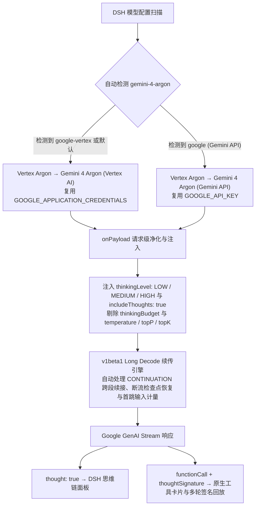

<div align="center">
  
  <h1>dsh-vertex-argon</h1>
  <p><strong>Google Vertex AI &amp; Gemini API Dual-Route Gemini 4 Argon Plugin for <a href="https://github.com/deepseek-ai/deepseek-harness">DeepSeek Harness</a> (DSH)</strong></p>
  <p>
    <a href="https://www.npmjs.com/package/dsh-vertex-argon"></a>
    <a href="https://github.com/deepseek-ai/deepseek-harness"></a>
    <a href="https://docs.cloud.google.com/gemini-enterprise-agent-platform/models/gemini/4-argon"></a>
    <a href="./LICENSE"></a>
  </p>
</div>

---

`dsh-vertex-argon` 为 [DeepSeek Harness](https://github.com/deepseek-ai/deepseek-harness) (DSH) 提供完整的 **Gemini 4 Argon** 接入支持，自动聚合 **Google Vertex AI**（服务账号 / ADC）与 **Google Gemini Developer API**（AI Studio API Key）双通道，修复内置 `pi-ai` 适配器误传 `thinkingBudget` 导致的 `HTTP 400` 报错，完整打通原生三档思考、思维链（Thought Summaries）、`v1beta1` **Long Decode 跨段长生成自动续传**与带签名的多轮工具调用。

Current release: **[1.2.1](https://github.com/higekibaka/dsh-vertex-argon)** · [npm](https://www.npmjs.com/package/dsh-vertex-argon)

---

## ✨ 为什么需要这个插件？

| 能力维度 | DSH 内置 `google` / `google-vertex` 旧适配器 | `dsh-vertex-argon` 插件通道 |
|---|---|---|
| **思考控制参数** | 误判为旧模型并发送 `thinkingBudget: -1`，触发云端 `HTTP 400` | 原生发送 `thinkingLevel: "LOW" \| "MEDIUM" \| "HIGH"`，绝不传 `thinkingBudget` |
| **思维链（思考摘要）** | 手动新增模型默认无 `reasoning` 标记，不请求摘要 | 固定开启 `includeThoughts: true`，流式解析 `thought: true` 实时展示思维链 |
| **多轮工具调用回传** | 路由切换或签名不对齐时易丢失上下文 | 保持 `provider` / `model` 与 `thoughtSignature` 签名全链路一致 |
| **Long Decode 长生成** | Vertex 硬编码 `v1` 且锁死 64K，遇 `CONTINUATION` 直接抛错断流 | 自动切换 `v1beta1` 跨 64K 分段零延迟续传（最高 512K）、断流检查点指数退避恢复，按首跳输入上报水位防误压缩 |
| **采样参数净化** | 可能携带被 Argon 拒绝或忽略的采样字段 | 自动剥离 `temperature`、`topP`、`topK` 等无效采样参数 |
| **通道管理与设置** | 需手改 `cordis.patch.yml` 并反复排查校验报错 | 自动检测双通道 + 内置 **设置 → Vertex Argon** 图形化实时调节页面 |

---

## 🔄 工作原理与架构流向



除提供独立的 **Vertex Argon** 分组外，插件在启动时还会为内置 `PiAiAdapter` 注入 `installGemini4PiAiPatch` 运行时兜底——即便用户在模型选择器中误点了原 `Google` 或 `Google Vertex AI` 分组下的 `gemini-4-argon`，也会被自动改写为合法的 `thinkingLevel` 请求。

---

## 🚀 安装方法

### 方式 1：在 DSH 对话框中一键安装（推荐）

直接向当前 DSH 会话发送：

```text
请用 plugin_manager 的 install_bundle 安装 dsh-vertex-argon
```

> 若本机默认配置了尚未同步新包的镜像源，可发送：
> `请用 plugin_manager 的 install_bundle 从 https://registry.npmjs.org/ 安装 dsh-vertex-argon`

### 方式 2：使用 DSH CLI 安装

```sh
dsh plugin --profile web add dsh-vertex-argon
```

---

## 🔑 双通道凭据配置（二选一或同时配置）

### 通道 A：Google Vertex AI（服务账号 JSON / ADC）

1. 在 [Google Cloud 控制台](https://console.cloud.google.com/) 确认项目已绑定结算账户、已启用 **Vertex AI API**（`aiplatform.googleapis.com`），并为服务账号授予 **Vertex AI User**（`roles/aiplatform.user`）角色，下载 JSON 密钥文件。
2. 在系统用户环境变量中设置以下 3 项（Windows 打开「编辑账户的环境变量 → 用户变量」新建，**变量值不要加引号**）：

| 环境变量名 | 填写示例 | 说明 |
|---|---|---|
| `GOOGLE_APPLICATION_CREDENTIALS` | `C:\Keys\vertex-sa.json` | 服务账号 JSON 密钥文件的完整本地路径 |
| `GOOGLE_CLOUD_PROJECT` | `my-gcp-project-id` | Google Cloud **项目 ID**（注意不是项目名称） |
| `GOOGLE_CLOUD_LOCATION` | `global` | 调用区域，推荐 `global`（或 `us` / `eu`） |

3. **完全退出 DSH（含右下角系统托盘图标）并重新启动**，使进程继承新的环境变量。
4. 在会话模型选择器中选择 **`Vertex Argon → Gemini 4 Argon (Vertex AI)`**。

### 通道 B：Google Gemini API（AI Studio API Key）

1. 打开 DSH **设置 → 模型 → Google**，配置你的 `GOOGLE_API_KEY`。
2. 在 `Google` 提供商下添加模型 ID：`gemini-4-argon`。
3. 插件会自动检测到该配置，并在模型选择器的 **`Vertex Argon`** 分组下多显示一项 **`Gemini 4 Argon (Gemini API)`**，点击即可直接调用。

---

## ⚙️ 设置页面与配置项（Configuration）

打开左下角 **设置 → Vertex Argon**，无需修改 YAML 或重启应用，即可实时调整以下配置（对应 `local-vertex-argon` Profile 条目）：

| 配置字段 | 默认值 | 可选范围 / 预设 | 说明 |
|---|---|---|---|
| `showInModelPicker` | `true` | `true` / `false` | 是否在会话模型选择器中显示 `Vertex Argon` 分组（隐藏不影响已打开会话） |
| `reasoning` | `medium` | `low` / `medium` / `high` | 默认思考档位，分别映射为原生 `LOW` / `MEDIUM` / `HIGH` |
| `longDecode` | `true` | `true` / `false` | 是否启用 `v1beta1` Long Decode 跨段自动续传（含断流检查点恢复与首跳输入防误压缩） |
| `maxTokens` | `65536` | `1` – `524288` | 最大输出预算（默认 `65,536`；开启 `longDecode` 后最高可设为 `524,288` 跨 64K 分段续传） |
| `contextWindow` | `1048576` | `1` – `1048576` | 输入、思考与输出共享的总上下文窗口（官方上限为 `1,048,576`） |

---

## ⚠️ 与 `billion-context` 配合使用的兼容性说明

在 `billion-context`（`0.1.196` / `0.1.197`）下启用 Google 通道代理时，存在两个属于代理侧处理链路的已知兼容性问题（均已向上游提交 Issue 并有对应修复 PR 跟进）：

### 1. Vertex AI 工具续答 `HTTP 400`（`user.parts` 顺序校验）

工具执行完毕后，若 `billion-context` 向最后一条 `user` 消息追加压缩提醒（nudge），会形成 `[functionResponse, text]` 的数组顺序，触发 Vertex AI 报错：

> `HTTP 400: Requests ending with a model turn are not supported.`

- **根因说明**：报错文案具有一定误导性——实际请求仍以 `user` 角色结尾且工具结果完好，触发校验的真正原因是同一条 `user` 消息内的 **`parts` 排列顺序**（与 `dsh-vertex-argon` 的 `thinkingLevel` 或思考摘要配置无关）。
- **端点对照**：

| 最后一条 `user` 消息的 `parts` 顺序 | Google Vertex AI | Google Gemini Developer API |
|---|---|---|
| `[functionResponse]`（无追加提醒） | `200 OK`，正常续答 | `200 OK`，正常续答 |
| `[functionResponse, text]`（工具结果后追加提醒） | **`400 Bad Request`** | 未复现该顺序 `400` |
| `[text, functionResponse]`（普通文本置于工具结果前） | `200 OK`，正常续答 | `200 OK`，正常续答 |

- **修复归属**：`dsh-vertex-argon` 的 `onPayload` 钩子运行在 `billion-context` 介入之前，无法在前置阶段调整代理后续注入的提醒顺序；该问题需由 `billion-context` 在 Google 请求转换与提醒注入阶段（`coreToGoogle` / `appendGoogleNudge`）统一处理。
  - 上游跟踪：[Issue #3159](https://github.com/ranxianglei/billion-context/issues/3159) · [PR #3167](https://github.com/ranxianglei/billion-context/pull/3167)

### 2. 流式响应中独立 `thoughtSignature` 片段被过滤

在完整 `billion-context` 流式处理链路中，Vertex AI 与 Gemini Developer API 返回的思考摘要文本（`thought: true`）均可完整保留，但**不携带文本的独立 `{ thoughtSignature: "..." }` SSE 片段**会被当前的 [Google loop adapter](https://github.com/ranxianglei/billion-context/blob/master/src/loop/adapter-google.ts) 跳过。

- **实际影响边界**：
  - **工具调用签名（必需）**：绑定在 `functionCall` 上的签名若缺失会导致下一轮请求直接报 `400`；该类签名在正常工具调用中可随工具块保留。
  - **独立输出签名（非严格校验）**：根据 [Google 官方文档](https://ai.google.dev/gemini-api/docs/generate-content/thought-signatures)，非 `functionCall` 的独立签名用于跨轮次延续推理状态，缺失不会触发服务端 `400` 报错，但可能对长链路推理连贯性产生潜在影响。
  - 上游跟踪：[Issue #3158](https://github.com/ranxianglei/billion-context/issues/3158) · [PR #3162](https://github.com/ranxianglei/billion-context/pull/3162)

### 3. 上游修复合入前的临时规避方式

在等待上游合并发版期间，若需在开启 `billion-context` 的环境中稳定使用 Vertex AI，可在生效的 `billion-context` 配置中对目标上游设置路由级透传（仅跳过该路由的代理改写与压缩，不影响其他通道）：

```json
{
  "providers": {
    "https://aiplatform.googleapis.com": { "passthrough": true }
  }
}
```

> **提示**：若使用区域级 Vertex 端点（如 `https://us-central1-aiplatform.googleapis.com`）或 Gemini Developer API（`https://generativelanguage.googleapis.com`），请按实际请求的域名填写。仅关闭 `compress.injectNudge` 无法规避独立签名片段丢失；设置 `passthrough: true` 后该路由将直接透传，不再执行 `billion-context` 上下文压缩。

---

## ❓ 常见问题

- **为什么极简问题有时候不显示思维链文本？**
  插件已固定发送 `includeThoughts: true`，但 Google 云端会根据问题复杂度动态决定是否吐出可读摘要：遇到推理或工具调用任务时会返回思考摘要文本，极简问答可能仅返回 `thoughtSignature` 签名而不产出摘要文本，属官方正常机制。
- **Gemini 网页版订阅（Gemini Advanced）包含这里的费用吗？**
  不包含。无论是 Vertex AI 还是 Gemini Developer API，均按对应平台的 API 用量计费。

---

## 📄 License

[MIT](./LICENSE) © [hgk](https://github.com/higekibaka)
