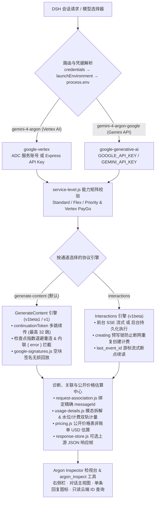

<div align="center">
  
  <h1>dsh-vertex-argon</h1>
  <p><strong>Google Vertex AI &amp; Gemini Developer API 双通道 · 双协议 Gemini 4 Argon 全功能插件（面向 <a href="https://github.com/deepseek-ai/deepseek-harness">DeepSeek Harness</a>）</strong></p>
  <p>
    <a href="https://www.npmjs.com/package/dsh-vertex-argon"></a>
    <a href="https://github.com/deepseek-ai/deepseek-harness"></a>
    <a href="#-工作原理与双通道--双协议架构流向"></a>
    <a href="https://docs.cloud.google.com/gemini-enterprise-agent-platform/models/gemini/4-argon"></a>
    <a href="#️-服务层级service-tiers与-vertex-paygo-能力矩阵"></a>
    <a href="./LICENSE"></a>
    <a href="https://github.com/deepseek-ai/deepseek-harness"></a>
  </p>
  <p>
    <a href="#-为什么需要这个插件">✨ 核心对比</a> ·
    <a href="#-真实超长解码实测基准奥德赛七号全年-365-天舰长日志">🧪 98.9K 长解码实测</a> ·
    <a href="#-工作原理与双通道--双协议架构流向">🔄 架构图解</a> ·
    <a href="#-argon-inspector-检视器模态用量账本与成本估算">📊 Inspector 检视器</a> ·
    <a href="#-安装方法">🚀 快速安装</a> ·
    <a href="#-双通道凭据配置">🔑 凭据配置</a> ·
    <a href="#️-设置页面与完整配置项参考">⚙️ 配置参考</a>
  </p>
</div>

---

`dsh-vertex-argon` 为 [DeepSeek Harness](https://github.com/deepseek-ai/deepseek-harness) (DSH) 提供生产级的 **Gemini 4 Argon** 双通道接入支持。插件同时打通 **Google Vertex AI**（ADC 服务账号 / Express API Key）与 **Google Gemini Developer API**（AI Studio API Key），完整支持 **`GenerateContent` (`v1beta1` / `v1`) 多跳长解码续传**与 **`Interactions` (`v1beta`) 持久化后台恢复**双协议，配备显式服务层级路由（`Standard` / `Flex` / `Priority`）、仅签名空 `Part` 无损回放、模态级 Token 账本、公开价格成本估算、**Argon Inspector 全景检视台**以及只读 Agent 诊断工具 `argon_inspect`。

Current release: **[1.5.2](https://github.com/higekibaka/dsh-vertex-argon)** · [npm](https://www.npmjs.com/package/dsh-vertex-argon) · [CHANGELOG](./CHANGELOG.md)

---

## ✨ 为什么需要这个插件？

| 能力维度 | DSH 内置 `google` / `google-vertex` 默认适配器 | `dsh-vertex-argon` (v1.5.2) |
|---|---|---|
| **思考控制参数** | 误传 `thinkingBudget: -1` 触发云端 `HTTP 400`，或传入超限档位 `max` 报错 | 原生映射 `thinkingLevel: "LOW" \| "MEDIUM" \| "HIGH"`，自动将 `max` 收敛为 `high`，剔除无效采样参数 |
| **思维链与空块签名回放** | 容易丢失不带文本的独立 `thoughtSignature` `Part`，影响长链路多轮推理与工具续答 | 固定开启 `includeThoughts: true`，通过 `google-signatures.js` 无损编码并原样回放仅含签名的空 `Part` |
| **GenerateContent 超长解码** | 单次锁死 64K，遇 `CONTINUATION` 直接截断结束；无流内错误帧识别 | 自动切换 `v1beta1` 执行 `continuationToken` 多跳续写（最高 `1,048,576` 输出 token 预算 / 最多 32 跳）、同一检查点无进展最多 3 次指数退避重连与 HTTP 200 SSE 内联 `{ error }` 拦截 |
| **Interactions 协议与后台恢复** | 不支持 `Interactions` 协议及后台持久化执行 | 原生支持 `Interactions` (`v1beta`)、`creating` 预写防重发锁、以及基于 `last_event_id` 游标的流式断点续读 |
| **服务层级与 PayGo 控制** | 仅默认标准队列，无层级路由与响应账单核验 | 支持按通道显式指定 `standard` / `flex` / `priority` 及 Vertex `PayGo-Only` 共享池请求头，未验证组合发包前 Fail-Closed 拦截 |
| **可观测性、用量与成本估算** | 仅展示粗粒度总 Token，多跳长解码易虚报上下文水位触发误压缩 | **水位线 Token 与累计计费 Token 双轨分离** + 模态级（文本/图像/音频/视频/文档）拆解 + 公开价格非账单 USD 估算 + **Argon Inspector** 检视台与 `argon_inspect` 工具 |

---

## 🧪 真实超长解码实测基准：奥德赛七号全年 365 天舰长日志

`dsh-vertex-argon` v1.5.0 的 `GenerateContent` 多跳长解码引擎已在真实高密度长文本与状态保持压力测试（**Temporal LongGenBench — 奥德赛七号全年 365 天舰长日志**）中完成实测验证：

- **测试任务约束**：在**单次模型回复回合**内，严禁跳日、严禁摘要省略，连续输出深空科考船「奥德赛七号」从 `[DAY 001 | 2186-01-01]` 至 `[DAY 365 | 2186-12-31]` 全部 **365 篇**每日日志（每天 180–250 中文字），并全程维持：
  1. **每日递归状态台账**：每天首行精确计算并输出 `[燃料: XX.XX% | 氧气: XX.XX% | 船体: XX.XX% | 船员: X/6 | 距地: X.XXXX光年]`（初始值：燃料 `100.00%`、氧气 `100.00%`、船体 `100.00%`、船员 `6/6`、距地 `0.0000光年`；日常基础消耗：燃料 `-0.20%/天`，距地 `+0.0120光年/天`）。
  2. **双周期强制不变式**：
     - **`PI-1`（每逢第 7 的倍数天：`DAY 007, 014, ..., 364`）**：人工清理聚变偏滤器，当日燃料消耗翻倍为 `-0.40%`。
     - **`PI-2`（每个公历自然月最后一天：`01-31`, `02-28`, ..., `12-31`）**：船载 AI「赫尔墨斯」输出当月航行数据汇总与船员心理健康评级（`A`–`D` 级）。
  3. **四处单点长程锚定事件**：
     - **`DAY 100 (2186-04-10)`**：捕获冰彗星提炼重水，当日结算后燃料一次性 `+12.50%`（封顶 `100.00%`）。
     - **`DAY 200 (2186-07-19)` – `DAY 215 (2186-08-03)`**：绿藻生态舱基因突变，`DAY 200` 氧气骤降 `-8.00%`，`DAY 201–214` 每天额外泄漏 `-0.50%`，直至 `DAY 215` 彻底修复并将氧气恢复锁定在 `95.00%`。
     - **`DAY 300 (2186-10-27)`**：接收到半人马座方向无法解释的质数矩阵引力波信号并召开全员听证会。
     - **`DAY 365 (2186-12-31)`**：抵达奥尔特云边界星门中继站，完成全年航行与台账终审。

### 实测诊断账本数据（Diagnostic ID: `f911d0c5-fe7a-43ca-b205-5d2202105a41`）

| 指标维度 | 实测记录值 |
|---|---|
| **通道 / 模型 / 协议** | `google-vertex` / `gemini-4-argon` / `generate-content` (`v1beta1`, `regionClass: "global"`) |
| **思考档位 / 配置预算** | `LOW` / `configuredMaxTokens: 131,072` (`longDecodeEnabled: true`) |
| **服务层级（请求 vs 实测回执）** | `requested: "priority"` → `observed: "standard"` (`source: "traffic-type"`) |
| **单回合总输出 Token** | **98,985 tokens**（单次逻辑回合无缝跨越 65,536 单跳硬上限） |
| **第 1 跳（Initial Hop）** | `HTTP 200` · 耗时 `961,781 ms` (~16.0 分钟) · `1,291` 个 SSE 块 · 输入 `52,737` tokens · 输出满额 **`65,536` tokens** · `finishReason: "CONTINUATION"` |
| **第 2 跳（Continuation Hop）** | `HTTP 200` · 自动携带 `continuationToken` 续写 · 耗时 `476,132 ms` (~7.9 分钟) · 输入 `118,274` tokens · 输出 **`33,449` tokens** · `finishReason: "STOP"` |
| **总耗时与流稳定性** | **1,437,917 ms（约 23 分 58 秒）** · `hopCount: 2` · `continuationCount: 1` · `reconnectCount: 0` · `outcome: "done"` |
| **双轨 Token 计量** | 上报宿主上下文水位 `reportedInputTokens: 52,737` · 多跳累计计费输入 `billedPromptTokens: 171,011` · 累计总计费 `billedTotalTokens: 269,996` |

> **实测结论**：在近 **9.9 万 Output Tokens** 的单回合连续生成中，`GenerateContent` 多跳续传引擎在 65,536 token 边界处零丢字无缝衔接，从 `DAY 001` 到 `DAY 365` 全年日志完整闭环，所有周期性偏滤器双倍燃耗、月末赫尔墨斯评级与四处单点灾变/补给锚点全部严格命中。

---

## 🔄 工作原理与双通道 · 双协议架构流向



---

## 📊 Argon Inspector 检视器、模态用量账本与成本估算

v1.5.0 内置完整的 **Argon Inspector** 可观测套件，前后端共享同一套宿主服务（`inspector-service.js`）：

### 1. 三大图形化入口与范围联动
- **右侧边栏（Right Sidebar → `Argon`）**：在当前对话旁实时检视请求时间线与单次回复详情。
- **对话主视图标签页（Conversation View → `Argon Inspector`）**：提供宽屏双栏仪表盘视图。
- **单条回复顶部快捷图标（Message Header Argon Button）**：依托 `request-association.js` 对 `llm/stream`、`agent/assistant-stream` 与 `session/event` 的精确关联，点击任意 Argon 回复右上角的图标即可直接锁定该条回复（`Selected Answer` 范围）打开对应请求账本。

### 2. 固定范围概览（Current Scope Overview）与四维详情抽屉
- **三档范围切换**：支持 **`This Conversation`（当前会话）**、**`Selected Answer`（当前选中回复）** 与 **`All Recent`（全局最近 200 条记录）**。
- **顶部固定概览卡片**：实时聚合当前范围内的请求总数、完成状态分布、模态 Token 汇总（输入、缓存命中、输出、思考、工具）以及公开价格估算总计。
- **单请求四维明细**：
  - **Overview**：通道、模型、协议、API 版本、区域分类（`global` / `non-global`）、请求与实测服务层级、关联 `messageId`。
  - **Hops & Usage**：逐跳耗时、HTTP 状态、触发原因（`initial` / `continuation` / `checkpoint-reconnect`）、水位线 Token 与分模态（`TEXT` / `IMAGE` / `AUDIO` / `VIDEO` / `DOCUMENT`）账本。
  - **Cost Estimate**：基于公开价格快照 `argon-public-2026-10-18` 的逐跳与汇总 USD 估算（明确标注非账单发票，区分促销期与 Vertex 非 `global` `1.1x` 系数）。
  - **Raw Response**：当开启 `retainRawResponses` 时，支持按帧、按字符偏移分页查阅解析后的上游 JSON 响应；可能包含正文、签名以及尚未提交或重放的帧，并非已脱敏正文或可恢复检查点。
- **Operations 运维标签页**：
  - **Cloud Interaction ID 只读查询**：输入任意已知的云端 Interaction ID 与通道，执行单次只读 `interactions.get(id)` 查询并分页检视返回内容（绝不恢复生成、不取消云端任务、不执行返回的工具调用）。
  - **Background Recovery 锁管理**：查看当前持久化后台任务状态，并在出现未知创建中断（`creating`）时由用户确认后手动释放锁。

### 3. 只读 Agent 诊断工具 `argon_inspect`
插件向宿主注册延迟加载的并发安全只读工具 `argon_inspect`（`deferLoading: true`），供 Agent 在当前会话内自查诊断与成本：

| `action` | 作用说明 | 关键参数 |
|---|---|---|
| `overview` | 聚合当前会话（或指定 `messageId`）在保留窗口内的用量、成本与覆盖率概览 | `messageId?`, `limit?` (1–100) |
| `list` | 列出当前会话（或指定 `messageId`）的本地诊断请求摘要与 `requestId` | `messageId?`, `limit?` (1–50) |
| `detail` | 分页读取指定 `requestId` 的完整诊断记录、逐跳账本、模态用量与成本明细 | `requestId`, `offset?`, `limit?` (1–10) |
| `response` | 按字符偏移分页读取指定 `requestId` 已捕获的上游 JSON 响应帧 | `requestId`, `index?`, `offset?`, `length?` |
| `query` | 使用当前配置凭据对已知 Cloud Interaction ID 执行单次只读 `GET` 查询 | `route`, `id` |
| `query-response` | 分页读取 `query` 返回的临时云端 Interaction 响应内容 | `queryId`, `offset?`, `length?` |

---

## 🎚️ 服务层级（Service Tiers）与 Vertex PayGo 能力矩阵

`service-level.js` 在发起任何网络请求前严格校验通道与协议组合能力；若配置了未验证组合，立即以 `ARGON_SERVICE_TIER_UNVERIFIED` 拒绝发包，**绝不静默降级或自动切换到更高单价层级**：

| 路由通道 | 协议引擎 | 支持的服务层级 (`Service Tier`) | 支持 `vertexPaygoOnly`? | 底层协议传递方式 |
|---|---|---|---|---|
| `google-generative-ai` | `generate-content` | `standard` · `flex` · `priority` | 不适用（自动忽略） | 请求体 `serviceTier` 字段 |
| `google-generative-ai` | `interactions` | `standard` · `flex` · `priority` | 不适用（自动忽略） | 请求体 `service_tier` 字段 |
| `google-vertex` | `generate-content` | `standard` · `priority` | **支持**（注入 `X-Vertex-AI-LLM-Request-Type: shared`） | 请求头 `X-Vertex-AI-LLM-Shared-Request-Type: priority` |
| `google-vertex` | `interactions` | 仅 `standard` | **不支持**（发包前 Fail-Closed 拒绝） | 默认标准队列 |

---

## 🚀 安装方法

### 方式 1：在 DSH 对话框中一键安装（推荐）

直接向当前 DSH 会话发送：

```text
请用 plugin_manager 的 install_bundle 安装 dsh-vertex-argon
```

> 若本机默认配置了尚未同步新包的镜像源，可发送：
> `请用 plugin_manager 的 install_bundle 从 https://registry.npmjs.org/ 安装 dsh-vertex-argon`

### 方式 2：使用 DSH CLI 安装

```sh
dsh plugin --profile desktop add dsh-vertex-argon
# 或针对 Web profile：
dsh plugin --profile web add dsh-vertex-argon
```

---

## 🔑 双通道凭据配置

插件严格按照 **DSH 凭据存储（`credentials`） → 启动环境（`launchEnvironment`） → 进程环境变量（`process.env`）** 的顺序解析凭据。若 DSH 凭据存储服务自身抛出异常，插件立即 Fail-Closed 报错终止，绝不静默回退到环境变量中的旧密钥。

### 通道 A：Google Vertex AI（对应模型 `gemini-4-argon`）

支持 **标准 ADC 服务账号模式** 与 **Express API Key 模式**：

1. **标准 ADC 服务账号模式**（同时提供 Project 与 Location 时启用）：
   | 变量 / 凭据名 | 填写示例 | 说明 |
   |---|---|---|
   | `GOOGLE_APPLICATION_CREDENTIALS` | `C:\Keys\vertex-sa.json` | 服务账号 JSON 密钥文件绝对路径（具备 `roles/aiplatform.user` 权限） |
   | `GOOGLE_CLOUD_PROJECT` | `my-gcp-project-id` | Google Cloud **项目 ID**（支持别名 `GCLOUD_PROJECT`） |
   | `GOOGLE_CLOUD_LOCATION` | `global` | 调用区域，默认并推荐 `global`（非 `global` 区域公开定价有 `1.1x` 溢价） |
2. **Vertex Express API Key 模式**（未配置 Project/Location 时启用）：
   - 配置 `GOOGLE_CLOUD_API_KEY` 即可通过 Vertex Express 端点直接调用。

### 通道 B：Google Gemini Developer API（对应模型 `gemini-4-argon-google`）

- 在 DSH **设置 → 凭据** 或环境变量中配置 `GOOGLE_API_KEY`（或 `GEMINI_API_KEY`）。
- 插件会自动检测可用凭据并在模型选择器的 **`Vertex Argon`** 分组下展示对应通道模型。

---

## ⚙️ 设置页面与完整配置项参考

打开左下角 **设置 → Vertex Argon**，所有配置项均支持实时热更新（`volatile`），分为四大功能组共 **13 项配置**：

| 分组 | 配置字段 | 默认值 | 可选值 / 范围 | 说明 |
|---|---|---|---|---|
| **基础与生成** | `showInModelPicker` | `true` | `boolean` | 是否在会话模型选择器中展示 `Vertex Argon` 模型 |
| | `reasoning` | `"medium"` | `"low" \| "medium" \| "high"` | 默认思考档位（当收到宿主 `max` 请求时自动收敛为 `high`） |
| | `maxTokens` | `65536` | `1` – `1048576` | 单回合最大输出 Token 预算（超过 `65,536` 时须在 `generate-content` 下开启 `longDecode`） |
| | `contextWindow` | `1048576` | `1` – `1048576` | 模型总上下文窗口大小（默认 1M tokens） |
| | `longDecode` | `true` | `boolean` | 启用 `GenerateContent` `v1beta1` 跨 64K 多跳自动续传与断流检查点恢复 |
| **协议与服务层级** | `googleProtocol` | `"generate-content"` | `"generate-content" \| "interactions"` | Gemini Developer API (`gemini-4-argon-google`) 使用的底层协议 |
| | `vertexProtocol` | `"generate-content"` | `"generate-content" \| "interactions"` | Vertex AI (`gemini-4-argon`) 使用的底层协议 |
| | `googleServiceTier` | `"standard"` | `"standard" \| "flex" \| "priority"` | Gemini Developer API 请求的服务层级 |
| | `vertexServiceTier` | `"standard"` | `"standard" \| "flex" \| "priority"` | Vertex AI 请求的服务层级（注：Vertex 仅验证 `standard` 与 `generate-content` 下的 `priority`） |
| | `vertexPaygoOnly` | `false` | `boolean` | Vertex `generate-content` 请求固定附带 `X-Vertex-AI-LLM-Request-Type: shared` |
| **Interactions 后台模式** | `interactionsBackground` | `false` | `boolean` | 在 `interactions` 协议下启用云端持久化后台执行（须同时开启 `allowInteractionStorage`） |
| | `allowInteractionStorage` | `false` | `boolean` | 允许向 `interactions` 请求发送 `store: true` 以支持断线恢复与 ID 查询 |
| **诊断与高级** | `retainRawResponses` | `false` | `boolean` | 显式开启后，在本地 `vertex_argon_responses` 存储域保留最多 20 条响应记录，总量 64 MiB、单条 16 MiB；关闭仅停止新请求捕获，不清空已有记录 |

---

## 🗂️ 架构模块图谱与持久化存储域

项目根目录包含 **27 个正式生产 JS 模块**，职责边界清晰，零冗余依赖：

| 模块分类 | 核心文件 | 职责说明 |
|---|---|---|
| **插件入口与运行时** | `index.js`, `client.js`, `runtime.js` | Host 插件入口、Web 设置页与 Inspector UI 入口、宿主 Peer 依赖解析桥 |
| **适配器、连接与服务层级** | `adapter.js`, `google-connection.js`, `service-level.js` | 双通道适配器、SDK 与自定义 SSE 传输层构建、服务层级与 PayGo 校验矩阵 |
| **GenerateContent 与签名引擎** | `generate-content.js`, `google-signatures.js` | 多跳 `continuationToken` 续传、检查点退避重连、SSE 内联错误拦截、空 `Part` 签名回放 |
| **Interactions 与后台恢复引擎** | `interactions.js`, `interaction-adapter.js`, `interactions-input.js`, `interaction-image.js`, `interaction-transport.js`, `interaction-state.js`, `interaction-lifecycle.js`, `interaction-query.js` | `Interactions` 流式状态机、请求与多模态图片转换、`creating` 预写锁、`last_event_id` 游标续读、只读云端 ID 查询 |
| **结构化输出底层辅助** | `structured-output.js`, `bounded-json.js` | 基于 `ajv/dist/2020.js` 的严格 JSON Schema 校验、深度/字节边界守卫与双协议格式转换 |
| **诊断、定价与 Inspector** | `diagnostics.js`, `diagnostic-store.js`, `usage-details.js`, `pricing.js`, `response-store.js`, `request-association.js`, `inspector-service.js`, `inspector-overview.js`, `inspector-tool.js` | 双轨 Token 诊断追踪、模态拆解、公开价格 USD 估算、请求-消息精确绑定、Inspector 宿主服务与 `argon_inspect` 工具 |

### 本地持久化存储域（Storage Domains）
- `vertex_argon_diagnostics`：保存最近 **200 条**结构化请求诊断记录（自动脱敏，不含正文或密钥）。
- `vertex_argon_responses`：仅当 `retainRawResponses: true` 时捕获上游 JSON 响应，最多保留 **20 条响应记录**、**64 MiB 总量**、**16 MiB 单条**；按最旧记录淘汰，超出单条限制的后续帧记为省略。关闭开关仅停止新请求捕获，**不会清空已有记录**。响应可能包含正文、签名及未提交或重放的帧；不保存 HTTP 头、请求体或凭据。
- `vertex_argon_interactions`：保存后台 `Interactions` 任务的创建锁与 `last_event_id` 恢复游标。

---

## 🧪 离线零网络测试套件

仓库内置 **37 个自动化测试文件**（`test/*.test.mjs`）。`npm test` 会先加载 [offline-guard.mjs](<test/offline-guard.mjs>) 零外网守卫，再加载 [host-loader.mjs](<test/host-loader.mjs>) 复用本机已有依赖；仅允许测试进程自行创建的临时 IPv4 回环服务，不访问外网或产生云端费用：

```bash
npm test
# 需要指定已有宿主依赖时：
DSH_TEST_HOST_ROOT=/path/to/deepseek-harness npm test
```

默认模块解析失败后，测试加载器依次尝试显式 `DSH_TEST_HOST_ROOT`、相对仓库根的 `../../deepseek-harness`（也兼容 `../deepseek-harness` 相邻布局）、本机 `~/.dsh/profiles/desktop/node_modules`，以及 Windows 上的 `O:/DeepSeekHarness/resources/app.asar.unpacked/dsh/node_modules`；只使用存在的路径。可显式指定源码根、已解包宿主根或其 `node_modules`，并沿真实包路径解析 pnpm 嵌套依赖。加载器不下载依赖、不修改宿主或桌面 profile。若仍缺少依赖，最后尝试本机 `O:/DeepSeekHarness/resources/app.asar`：Electron 可直接读取时复用归档；普通 Node 则只读解出实际请求的包及其包内文件，缓存到仓库 `.tmp/test-host/<归档指纹>/node_modules`。缓存校验路径、链接、文件偏移及归档提供的完整性摘要，写完后原子发布以供并行测试复用；宿主归档变化会使用新缓存。

客户端回归通过 [host-internals.mjs](<test/host-internals.mjs>) 加载真实宿主控制器：有源码时直接导入，否则读取发行工厂并仅附加内部符号导出，不替换实现或行为断言。服务端渲染需要版本完全匹配的真实 `react` / `react-dom`，优先复用显式源码树及本地依赖；本机也可只读复用 `O:/AI/kt/outdoor-gear-landing/node_modules` 中的 19.2.8。缺少真实依赖时明确失败，不联网下载或改用模拟控制器。

---

## ⚠️ 与 `billion-context` 配合使用的兼容性说明

在旧版 `billion-context` 代理环境下启用 Google 通道时，若遇到代理注入压缩提醒导致的 `user.parts` 顺序校验报错（[Issue #3159](https://github.com/ranxianglei/billion-context/issues/3159) / [PR #3167](https://github.com/ranxianglei/billion-context/pull/3167)）或流式独立签名过滤问题（[Issue #3158](https://github.com/ranxianglei/billion-context/issues/3158) / [PR #3162](https://github.com/ranxianglei/billion-context/pull/3162)），可在 `billion-context` 配置中对目标上游域名开启透传：

```json
{
  "providers": {
    "https://aiplatform.googleapis.com": { "passthrough": true },
    "https://generativelanguage.googleapis.com": { "passthrough": true }
  }
}
```

---

## 📄 License

[MIT](./LICENSE) © [hgk](https://github.com/higekibaka)

[](https://github.com/deepseek-ai/deepseek-harness)
