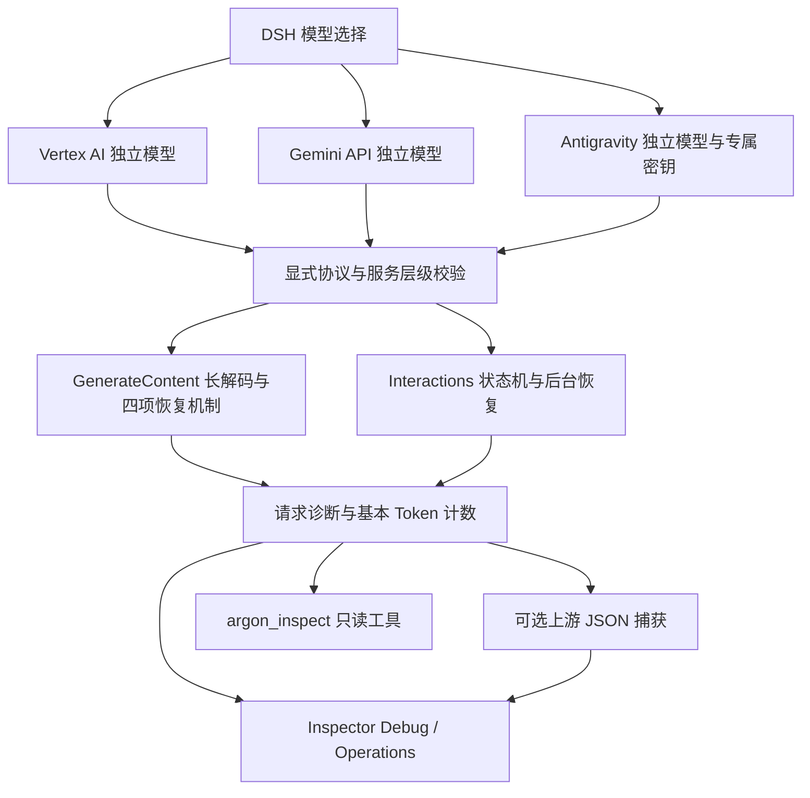

# dsh-vertex-argon 实现架构与模块边界（v1.6.3）

本目录描述当前本地工程；实现合同见 [DECISIONS.md](<DECISIONS.md>)，本轮验证与历史实测分开记录于 [STATUS.md](<STATUS.md>)。文档更新不表示插件已安装、已发布或新增了云端验证。

## 1. 插件与宿主边界

- 包名 `dsh-vertex-argon`，Host 注册名 `local-vertex-argon`，Provider ID `google-vertex-argon`。
- 保留用户工程版本 `1.6.3`，支持 DSH `0.2.1-rc.2 || 0.2.1-rc.3`；Node.js `^22.19.0 || >=24.0.0`。元数据以 [package.json](<../../package.json>) 为准。
- 仅使用宿主公开的 `llm`、`storageDomain`、`typert`、`settings`、`tools` 与 Web Client Slots，不修改宿主源码、已安装归档或 profile。
- `installGemini4PiAiPatch` 保留对原生 `google` / `google-vertex` 的 Gemini 4 调用修正；不引入隐式辅助模型请求。

## 2. 三个独立模型、两种协议路由

| 模型 | 连接目标 | `route` | 配置来源 |
|---|---|---|---|
| `gemini-4-argon` | Vertex AI | `google-vertex` | `vertexProtocol` / `vertexServiceTier` |
| `gemini-4-argon-google` | Gemini API | `google-generative-ai` | `googleProtocol` / `googleServiceTier` |
| `gemini-4-argon-proxy` | Antigravity Proxy | `google-generative-ai` | 复用 Google 协议与服务层级；独立地址/密钥 |
| `gemini-3.8-flash-proxy` | Antigravity Proxy | `google-generative-ai` | 同上；与 Argon 共用代理地址与专属密钥 |

代理由 `proxyEnabled || explicitRoutes.hasProxy` 开启，默认关闭。`PROXY_MODEL` / `PROXY_FLASH_MODEL` 都是独立模型 ID，不新增第三种诊断路由枚举；`isProxyModel` 是两个代理模型的唯一判定入口。界面依据 `model` 显示 Antigravity；云端 ID 查询仍仅支持 Google/Vertex，不据诊断路由推断代理凭据。

## 3. 生产模块职责

### 入口与配置

- [index.js](<../../index.js>)：16 项 `volatile` 配置、存储域、Typert 服务、请求关联事件与延迟加载工具注册。配置完整表见 [主文档](<../../README.md#完整配置16-项>)。
- [client.js](<../../client.js>)：设置页面（含 Antigravity 三字段卡片）、右侧栏/会话主视图/回复快捷入口，以及 **Debug / Operations** 两个工作区；不挂载范围聚合仪表盘。
- [runtime.js](<../../runtime.js>)：从现有宿主解析 `@deepseek-ai/*`、`@earendil-works/pi-ai`、`@google/genai`、`zod` 等依赖。

### 路由、连接与服务层级

- [adapter.js](<../../adapter.js>)：三模型注册、配置快照与缓存失效、凭据解析、代理 URL 规范化和原生适配器补丁。代理 Key 仅取已去空白的设置值或 `ANTIGRAVITY_API_KEY`，不与 Google/Vertex 混用。
- [google-connection.js](<../../google-connection.js>)：创建 `GoogleGenAI` 与 Interactions 传输；显式 Key 覆盖和专属环境键确保代理隔离。
- [service-level.js](<../../service-level.js>)：既有服务层级/PayGo 能力矩阵与真实回执提取；代理沿用 Google 路由，不扩展矩阵。

### GenerateContent 与签名

- [generate-content.js](<../../generate-content.js>)：`continuationToken` 多跳引擎；HTTP 200 内联错误与服务端延时、分阶段超时、零已交付分片的初始重试、仅思考 STOP 一次自愈。每跳独立取消与清理；首检查点前实时输出，检查点后仅提交确认段，恢复时丢弃未提交尾段。
- [google-signatures.js](<../../google-signatures.js>)：仅含 `thoughtSignature` / `thought_signature` 的空 `Part` 保真回放。

### Interactions 与后台恢复

- [interactions.js](<../../interactions.js>)：流式状态机、后台轮询与 `last_event_id` 断点续读。
- [interaction-adapter.js](<../../interaction-adapter.js>)：适配请求、诊断、基本 Token 用量和原始响应捕获。
- [interactions-input.js](<../../interactions-input.js>) / [interaction-image.js](<../../interaction-image.js>)：历史消息、工具、图片等请求转换；删除诊断模态账本不等于删除多模态输入支持。
- [interaction-transport.js](<../../interaction-transport.js>)：`create` / `get` / `cancel` 传输与 SSE 解析。
- [interaction-state.js](<../../interaction-state.js>) / [interaction-lifecycle.js](<../../interaction-lifecycle.js>)：`creating` 预写锁、恢复状态、轮询生命周期。
- [interaction-query.js](<../../interaction-query.js>)：已知 Cloud Interaction ID 的只读单次 `GET`，仅 Google/Vertex。

### 结构化输出

- [structured-output.js](<../../structured-output.js>) / [bounded-json.js](<../../bounded-json.js>)：严格 JSON Schema 校验、字节/深度/节点边界与双协议格式转换，不新增独立付费命令。

### 诊断与 Inspector

- [diagnostics.js](<../../diagnostics.js>)：请求生命周期、11 项请求级 `tokenUsage`、每跳五项 Token 计数、故障阶段与恢复轨迹。
- [diagnostic-store.js](<../../diagnostic-store.js>)：严格新写入、窄范围旧字段读取兼容、环形缓冲与持久化；不改写历史磁盘记录。
- [response-store.js](<../../response-store.js>)：用户显式同意后的上游 JSON 响应捕获与字符分页，不是恢复检查点。
- [request-association.js](<../../request-association.js>)：跨请求克隆传递标记，精确绑定 `messageId` / `settlementSeq`，不能确认时放弃关联。
- [inspector-service.js](<../../inspector-service.js>) / [inspector-tool.js](<../../inspector-tool.js>)：请求列表、详情、响应与只读云端查询；工具动作保留 `list`、`detail`、`response`、`query`、`query-response`。

公开定价、模态诊断账本、范围概览聚合模块已退役，不再列入生产模块或对外功能。基本 Token 计数、逐跳错误、响应证据与完整 JSON 保留。

## 4. 持久化存储域

| 存储域 | 内容与边界 |
|---|---|
| `vertex_argon_diagnostics` | 最近 200 条请求诊断；输入水位与跨跳累计用量分开；读取历史时移除退役字段，但不回写旧文件 |
| `vertex_argon_responses` | `retainRawResponses: true` 才捕获新响应；最多 20 条、总计 64 MiB、单条 16 MiB；关闭不清空旧记录 |
| `vertex_argon_interactions` | 后台创建锁与已知任务的恢复游标；未知创建不自动重发 |

## 5. 离线测试与依赖边界

`npm test` 先加载 [offline-guard.mjs](<../../test/offline-guard.mjs>)，再加载 [host-loader.mjs](<../../test/host-loader.mjs>)。只允许测试进程自行创建的临时 IPv4 回环服务，禁止真实外网。测试数量与最终通过结果由负责人依据当轮日志补充到 [STATUS.md](<STATUS.md>)。

加载器保留 Node 正常解析，再按显式 `DSH_TEST_HOST_ROOT`、相邻源码树、desktop profile、已有解包依赖回退；最后可只读复用本机 ASAR，将需要的包缓存到仓库临时目录。路径/链接/文件偏移/完整性须校验，完整包原子发布给并发进程；不下载依赖，不修改宿主或 profile。

[host-internals.mjs](<../../test/host-internals.mjs>) 提供真实控制器/工厂和 ESM 产物选择，发行版缺源码时仅附加测试所需内部符号导出。SSR 与被测工厂共用匹配版本的真实 React；缺依赖应明确报告，不偷偷安装或换用模拟实现。
